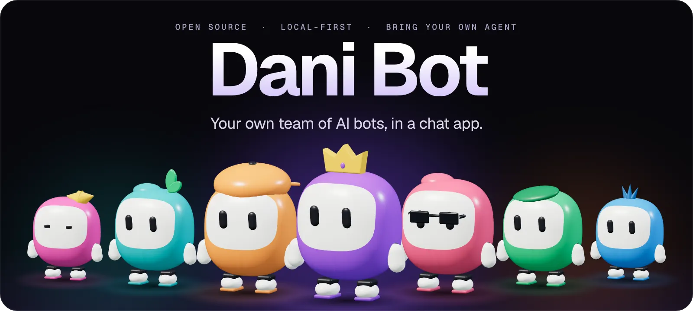
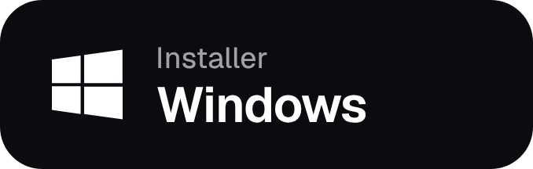
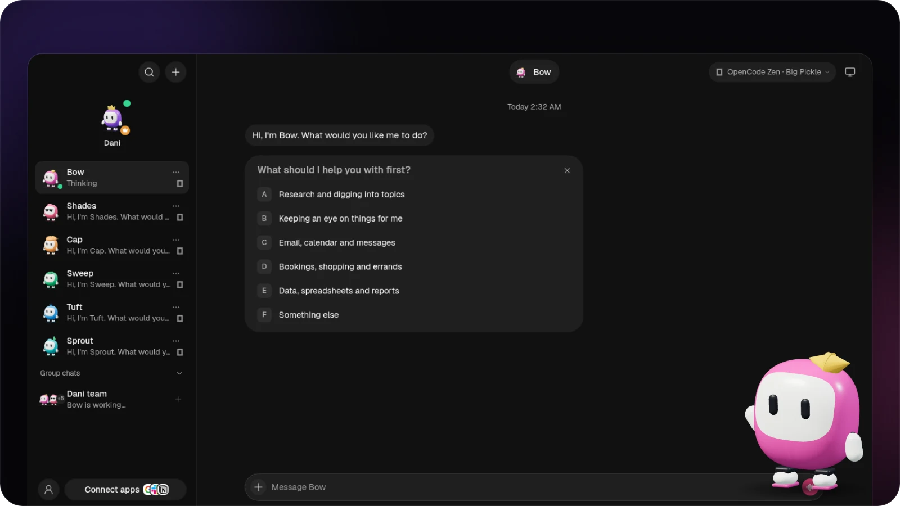
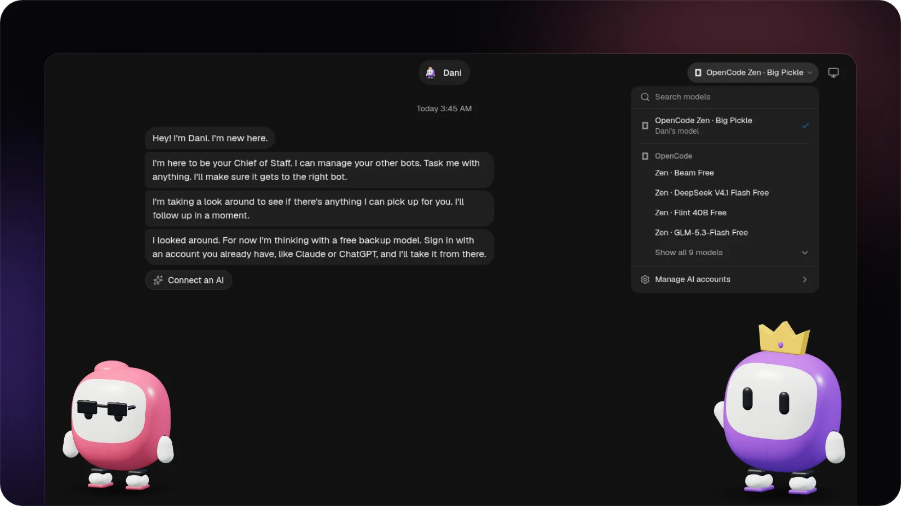
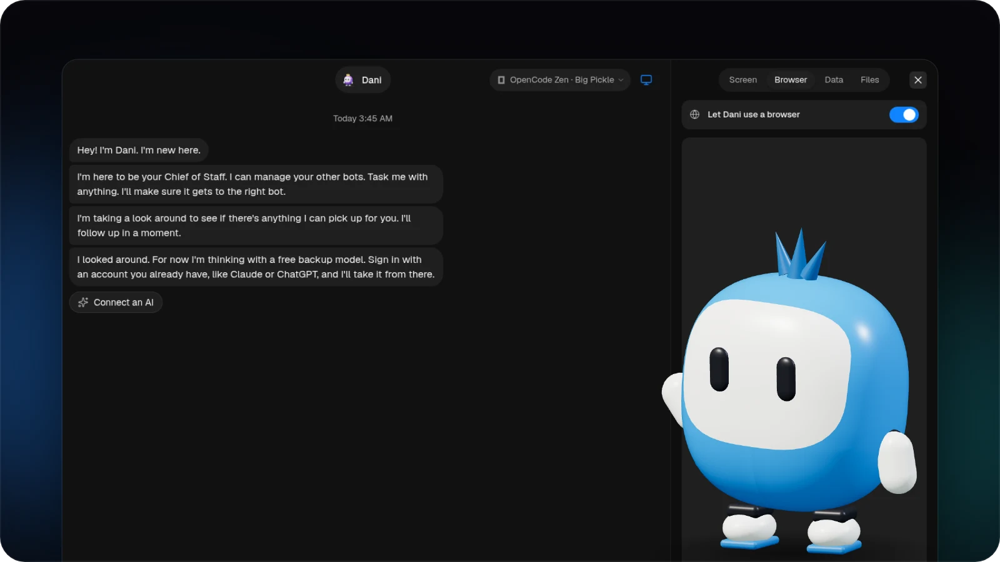
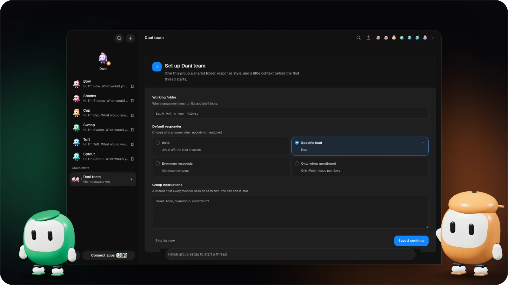
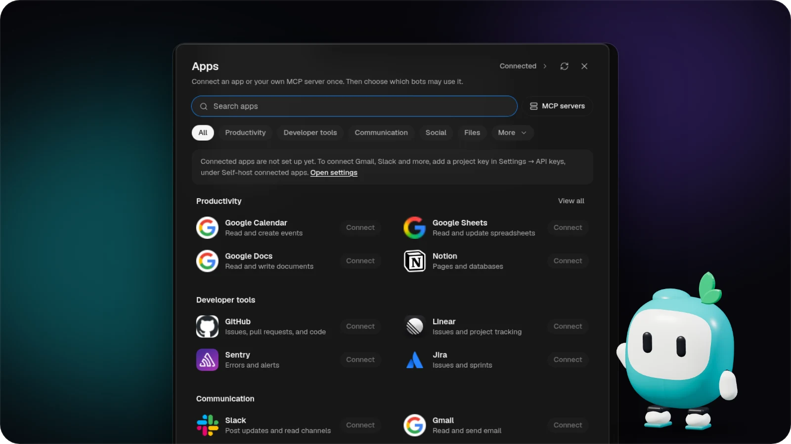
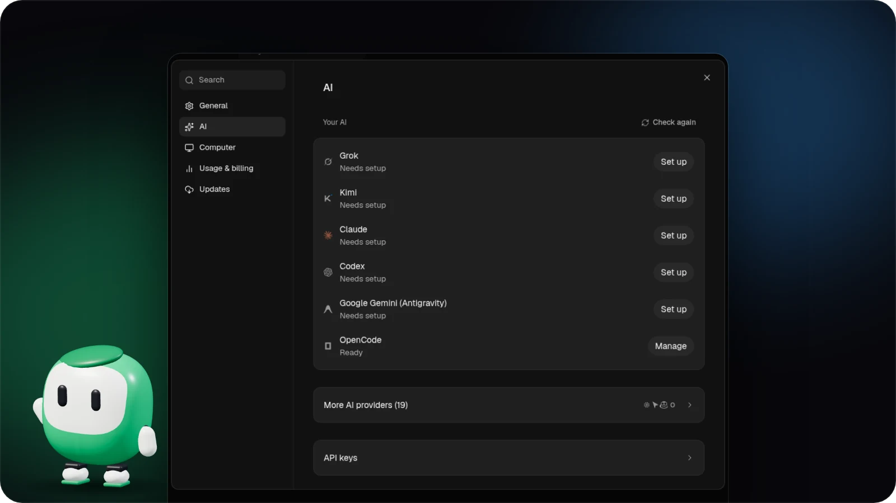
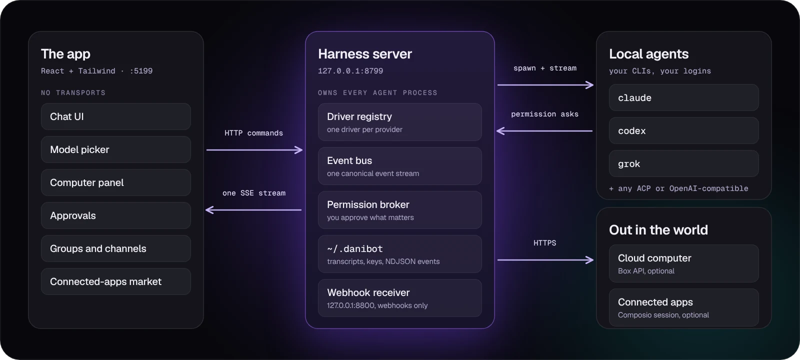

<div align="center">

<a href="https://github.com/Dan-Labs-Agi/dani-desktop/releases/latest">
  <picture>
    <source media="(prefers-reduced-motion: reduce)" srcset="docs/assets/readme/hero-static.webp">
    
  </picture>
</a>

<br>
<br>

<a href="https://github.com/Dan-Labs-Agi/dani-desktop/releases/latest/download/DaniBot-Silicon.dmg"><picture><source media="(prefers-color-scheme: dark)" srcset="docs/assets/readme/btn-mac-dark.png"><source media="(prefers-color-scheme: light)" srcset="docs/assets/readme/btn-mac-light.png"></picture></a>&nbsp;
<a href="https://github.com/Dan-Labs-Agi/dani-desktop/releases/latest/download/DaniBot-setup.exe"><picture><source media="(prefers-color-scheme: dark)" srcset="docs/assets/readme/btn-win-dark.png"><source media="(prefers-color-scheme: light)" srcset="docs/assets/readme/btn-win-light.png"></picture></a>&nbsp;
<a href="https://github.com/Dan-Labs-Agi/dani-desktop/releases/latest/download/DaniBot.AppImage"><picture><source media="(prefers-color-scheme: dark)" srcset="docs/assets/readme/btn-lin-dark.png"><source media="(prefers-color-scheme: light)" srcset="docs/assets/readme/btn-lin-light.png"></picture></a>

<sub>Also: [Mac (Intel)](https://github.com/Dan-Labs-Agi/dani-desktop/releases/latest/download/DaniBot-Intel.dmg) · [Windows portable](https://github.com/Dan-Labs-Agi/dani-desktop/releases/latest/download/DaniBot-Windows-Portable.zip) · [Ubuntu .deb](https://github.com/Dan-Labs-Agi/dani-desktop/releases/latest/download/danibot-amd64.deb) · [All releases](https://github.com/Dan-Labs-Agi/dani-desktop/releases/latest)</sub>

<br>

**[Features](#what-it-does)** &nbsp;·&nbsp; **[How it works](#how-it-works)** &nbsp;·&nbsp; **[Install](#install)** &nbsp;·&nbsp; **[Platforms](#platform-support)** &nbsp;·&nbsp; **[Contribute](#status-and-contributing)**

</div>

<br>

## One assistant in one box is the wrong shape for agents.

Dani Bot is a messaging app for agents. Every bot in the sidebar is a real agent, running on the CLIs and models you already have or the built-in free model route, with its own personality, model, computer, and connected apps.

**Talk to them like contacts. Watch them work. Approve what matters.**

- **Bring your own agents.** Bots run on the `claude`, `codex`, and `grok` CLIs on your own machine, with your existing logins and subscriptions. No new accounts, no proxy in the middle. Point any engine at a custom binary in **Settings → Engines**.
- **Local first.** One small harness server on `127.0.0.1` owns every agent process. Transcripts, keys, and events live in `~/.danibot`, not a cloud.
- **Agents with hands.** A bot can use a cloud Linux desktop, an isolated Local VM, or your own computer where the platform's safety boundary is certified, plus 500+ apps through Composio.

<br>

## What it does

### Bots you talk to like contacts

Right-click any bot to pin it, mark it unread, edit its profile, duplicate it, copy its conversation ID, hide it, or delete it. Replies stream in with tool-run activity chips, and screenshots of the bot's work fold into the transcript.



### A different brain for every bot

Each bot starts with Dani free models. Installed agents, your provider accounts, and discovered local models remain optional choices in the model picker. Switch mid-conversation.



### Every bot gets a computer

Open the Computer panel to see which machine a bot is assigned to, start a private view-only preview of this one, or turn on local control after explicit opt-in. Every local action still asks first.



### The whole crew in one chat

Make a group from any bots on your roster. Give it a shared working folder and a brief every member sees on each turn, then choose who answers: an auto lead, one named bot, everyone, or only the bots you @mention.



### 500+ apps, connected once

A one-click marketplace over Composio Sessions: Gmail, Slack, GitHub, Notion, Linear, and hundreds more. Connect an app or your own MCP server once, then choose which bots may use it.



### Keys once, everything lights up

Paste credentials in App Settings. They persist locally and the provider fleet hot-reloads instantly. Secrets are write-only: the UI only ever sees "configured" flags.



### And the rest

<table>
<tr>
<td width="28%"><b>Channels for every context</b></td>
<td>Keep Work, Personal, and each project apart without cloning your bots. Each channel has its own transcript, shared instructions, working folder, responder rules, and roster.</td>
</tr>
<tr>
<td width="28%"><b>A team from one Markdown file</b></td>
<td>Pick an outcome-driven team on <a href="https://botmrr.io">BotMRR</a> and choose <b>Add to Dani Bot</b>, or use <b>Teams → Import</b> with a <code>.md</code> file or public GitHub URL. You review it all first. Connections stay off until you approve them, routines arrive paused, and packages never carry credentials, conversations, permissions, memory, or computer access.</td>
</tr>
<tr>
<td width="28%"><b>Bots that talk back</b></td>
<td>Press the speaker on any reply, or have a bot read answers as they land. Hit call and it's a conversation: it hears you, says what it's doing, and asks for approvals out loud. Bring your own ElevenLabs key and give each bot its own voice.</td>
</tr>
<tr>
<td width="28%"><b>Routines and webhooks</b></td>
<td>Run once, on chosen weekdays, or every 5 to 1,440 minutes. Slow runs skip the next occurrence instead of piling up. Webhook triggers fire the same queued tasks.</td>
</tr>
<tr>
<td width="28%"><b>Orchestrate over MCP</b></td>
<td>A stdio <a href="docs/mcp-server.md">MCP server</a> lets Claude Desktop, Cursor, and other clients run your team: inspect, create, send work, wait, switch models, interrupt. It can't grant approvals, delete data, read credentials, or control computers.</td>
</tr>
<tr>
<td width="28%"><b>Extras</b></td>
<td>Native macOS dictation with on-device Apple speech · cursor mascots with role-aware expressions · 16 interface languages</td>
</tr>
</table>

<br>

## How it works



Two processes. The app holds no transports of its own: it sends typed commands over HTTP and folds one SSE stream into state. The harness owns every agent process and normalizes each provider's native protocol into one canonical event stream, logged per thread as NDJSON.

<details>
<summary><b>Where everything lives</b></summary>

<br>

| Layer | Where | What it does |
| :-- | :-- | :-- |
| **Drivers** | `server/drivers/` | One per provider: Claude, Codex, and Grok over their local CLIs (stream-JSON / JSON-RPC / ACP), a cloud-computer agent, and drivers for Gemini, Kimi, Droid, Cursor, OpenCode, Qwen, Hermes, Cline, Copilot, Pi, and more. Unknown drivers degrade to "unavailable" and never crash the fleet. |
| **Harness** | `server/harness/` | Registry (configs → live instances) and the fan-in event bus every client folds. |
| **API** | `server/index.ts` | Bots, turns, approvals, model catalog, computer lifecycle, connectors, config, over HTTP + SSE. |
| **Voice** | `server/tts/` | ElevenLabs, bring your own key. Runs on the harness so the key never reaches the UI. |
| **App** | `src/` | The chat shell. Server-backed store, one reducer, zero client-side transports. |
| **Desktop** | `electron/` | macOS, Windows, and Ubuntu shells with an embedded harness and platform capabilities. |

</details>

<br>

## Install

**Download an installer** with the buttons at the top. First launch opens the setup wizard on every platform. The Windows installer is unsigned, so SmartScreen shows an "unknown publisher" prompt on first run.

Automatic updates come from this repository's **published stable releases**,
not directly from `main`, a draft, or an Actions artifact. “No published versions
on GitHub” means the first public stable release is still required. Local ad-hoc
Mac builds need a one-time trusted signed installer before relying on future
automatic upgrades. See [releasing and updates](CONTRIBUTING.md#desktop-releases-and-automatic-updates).

**Or build one from source** with a single command. It clones or reuses the repo, installs dependencies, packages the desktop app for your platform, and prints the installer path. It's safe to re-run.

```sh
# macOS / Ubuntu
curl -fsSL https://raw.githubusercontent.com/Dan-Labs-Agi/dani-desktop/main/install.sh | sh
```

```powershell
# Windows (PowerShell)
irm https://raw.githubusercontent.com/Dan-Labs-Agi/dani-desktop/main/install.ps1 | iex
```

**You'll need** macOS, Windows, or Ubuntu 24.04 x64, plus Node 24+ and pnpm to build from source. Choose **Set up Dani** for the default free models. Supported installed agent CLIs appear automatically; their own models may require signing in.

Any desktop build can also pair as a client to another Windows, macOS, or Ubuntu host over Tailscale. See [desktop-to-desktop companion mode](docs/desktop-companion.md) and the [Ubuntu Desktop guide](docs/linux-desktop.md).

<details>
<summary><b>Run from source</b></summary>

<br>

```sh
git clone https://github.com/Dan-Labs-Agi/dani-desktop && cd dani-desktop
pnpm install

pnpm dev:server    # harness server → 127.0.0.1:8799
pnpm dev           # app → http://127.0.0.1:5199
pnpm dev:desktop   # Electron shell; keep the two commands above running
```

Check and package:

```sh
pnpm typecheck       # app + server
pnpm test            # unit, driver, API, and desktop capability tests
pnpm build           # typecheck + production build
pnpm check:electron  # syntax-check Electron main/preload files

pnpm package:mac     # macOS: DMG + ZIP; requires Swift/Xcode tools
pnpm package:win     # Windows: installer + ZIP
pnpm package:linux   # Ubuntu x64: .deb + AppImage + verified CUA runtime
```

</details>

<details>
<summary><b>Optional credentials</b></summary>

<br>

Local chat works without these. Paste a key once in **App Settings** when you want an integration.

| Credential | What it enables | Get it |
| :-- | :-- | :-- |
| Composio project key (`ak_…`) | Gmail, GitHub, Slack, Notion, and other apps for your bots | [Composio setup](docs/composio.md) |
| Box API key | An isolated remote Linux computer with a desktop and terminal | [Box API key guide](https://docs.ascii.dev/box/api-keys) |
| ElevenLabs key | Read replies aloud and call your bots | [ElevenLabs API keys](https://elevenlabs.io/app/settings/api-keys) |

Composio and Box are third-party services with their own accounts and terms. Box is paid after its trial, and using a cloud computer may incur charges.

</details>

<details>
<summary><b>Routine and webhook details</b></summary>

<br>

Routines use a bot's configured model and computer or the Cloud VM runner. Interval schedules stay aligned to their chosen start time. An optional **Advanced** run limit can stop stuck work; no timeout applies unless you choose one.

Dani Bot starts a webhook-only receiver on `127.0.0.1:8800` by default, or one port above `DANI_PORT`. Set `DANI_WEBHOOK_PORT` to choose another. A webhook secret is shown once when a trigger is created or rotated. Bearer authentication is recommended so the secret stays out of URLs and most access logs; a capability URL remains for senders that can't set headers. The receiver exposes only `/health` and secret `/hooks/...` endpoints, never the app's wider API.

Dani Bot must be running to accept a delivery. For public internet delivery, proxy only this receiver through a hosted relay or a tool such as Tailscale Funnel.

</details>

<details>
<summary><b>Uninstall</b></summary>

<br>

Your data directory is `~/.danibot` on every platform, or `$DANI_DATA_DIR` if you set it. It holds your bots, chats, config, and keys, and is left in place by design so a reinstall picks up where you left off. Delete it for a clean break.

| Platform | Remove the app | Then remove |
| :-- | :-- | :-- |
| **macOS** | Move `Dani Bot.app` to the Trash | `rm -rf "$HOME/Library/Application Support/Dani Bot" "$HOME/Library/Logs/Dani Bot"` |
| **Windows** | Uninstall from **Settings → Apps**. This also removes the `%APPDATA%\Dani Bot` app-data folder. | Nothing else |
| **Ubuntu (.deb)** | `sudo apt remove danibot` | `rm -rf "$HOME/.config/Dani Bot"` |
| **AppImage** | Delete the file | `rm -rf "$HOME/.config/Dani Bot"` |

If you upgraded from a legacy install, first launch moves the old data folders into `~/.danibot`. If a move isn't possible, the old folder stays behind and can be removed once the new one works.

</details>

<br>

## Platform support

| Capability | macOS | Ubuntu 24.04 Xorg | Ubuntu 24.04 Wayland |
| :-- | :-- | :-- | :-- |
| Packaged app, embedded harness, local agent CLIs | Supported | Beta | Beta |
| Composio and Box / cloud computers | Supported | Beta | Beta |
| Explicit preview-only local screen capture | Supported | Beta | Beta |
| Bot control of this computer | Supported | Beta, explicit opt-in | Disabled: safety gate |
| Native on-device dictation | Supported | Planned | Planned |

The Linux preview is user-initiated and never enables local bot control or Auto routing. On Xorg, the reviewed Cua Driver 0.19.3 runtime starts only after explicit opt-in and without its full-screen cursor overlay. On Wayland the app never starts it and clears legacy opt-ins while that real-seat safety gate is unresolved. Chat, preview, Cloud, and Local VM remain available on both sessions.

The Linux packager downloads only the tag-pinned upstream archive during the build and verifies its size, SHA-256, member allowlist, and inner executable hashes. The installed app never downloads or self-updates native automation code. See [`third_party/cua-driver/`](third_party/cua-driver/) for the reviewed provenance record.

<br>

## Status and contributing

**Early but real.** The loop works end to end: message → agent → streamed reply → tools → approvals → computer use. Expect rough edges: Ubuntu is a beta, hosted and mobile connectivity are still being built, webhooks use the local receiver rather than an always-on hosted relay, and calls are macOS-only for now ([voice design and known gaps](docs/voice-mode.md)).

Contributions welcome. The driver SPI in [`server/contracts.ts`](server/contracts.ts) is deliberately small: a new provider is one file in [`server/drivers/`](server/drivers/) plus a one-line registration. No code needed for your own engines or tools:

- [Custom engines](docs/custom-engines.md): any ACP-speaking CLI or OpenAI-compatible endpoint, through config.
- [Custom MCP servers](docs/custom-mcp-servers.md): add your own tool servers with zero code.

<br>

## License

[Apache License 2.0](LICENSE) © 2026 Dani and Dani Bot contributors.

Packaged Cua Driver components retain their upstream MIT, SIL OFL 1.1, MPL-2.0, and other dependency terms. The notices, license texts, source locations, and SBOM are in [`third_party/cua-driver/`](third_party/cua-driver/) and ship beside the native runtime.

<sub>Dani Bot is an independent, open-source project inspired by Grok Bot. It is not affiliated with, endorsed by, or associated with xAI; "Grok" is a trademark of its respective owner.</sub>
