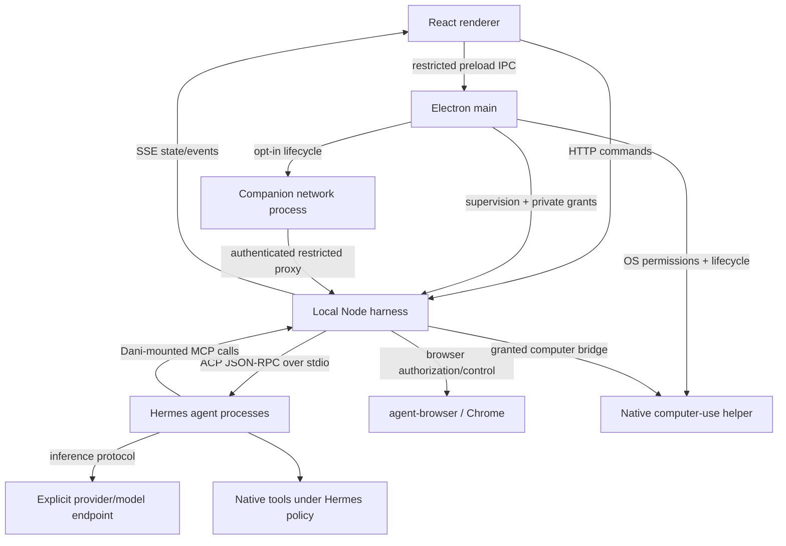
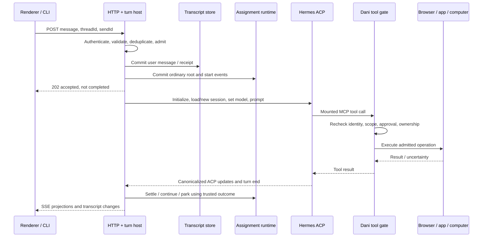
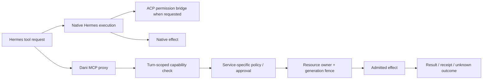
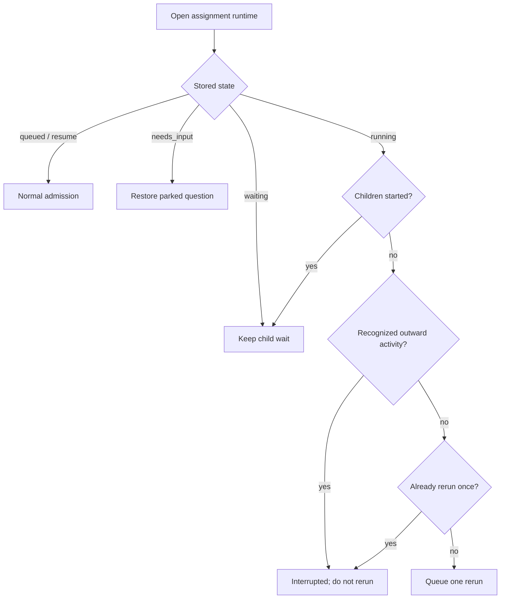

# Dani Desktop architecture assessment — 2026-11-13

## Decision

Keep the existing Electron/React desktop shell, local Node harness, Hermes ACP execution seam and SQLite-backed job runtime. Improve the existing modules and prove the installed product; do not introduce a second scheduler, general agent supervisor or replacement desktop framework without a measured requirement.

This is an architecture research report, not an implementation or production-readiness certification. `Observed` means exercised during this investigation; `Source` means inspected in the current working tree; `[INFERENCE]` identifies a conclusion not reproduced end to end. Recommendations are not implemented by this report.

## Scope and provenance

- Inspected working-tree source on `fix/dani-onboarding-updates-compact-sidebar`, HEAD `3a7797656f`, reported one commit behind its tracking branch. Baseline contained 187 unstaged and 32 untracked files; no application code or existing user changes were modified.
- Canonical origin: `https://github.com/Dan-Labs-Agi/dani-desktop.git`. Other configured remotes include the upstream OpenMausBot repository; upstream code/docs are not evidence of what this checkout ships.
- Package version `0.1.140-local.3`; package manager `pnpm@10.33.0`; required Node `>=24`; locally observed Node `v26.8.1`. Electron, React, Vite and TypeScript are declared in [package.json](../../package.json#L18-L44).
- Runtime checks used only disposable homes created by the documented [`control-omb` launcher](../verification/README.md#L24-L55). No real model call, personal browser, installed-app workspace, account change, release publication or live-data mutation was performed.
- Both owned fixture launchers exited with code 0 after Ctrl-C. Their server logs remain at the paths below; the launcher's close path stops its exact child and removes its temporary home ([implementation](../../scripts/control-omb.ts#L437-L447)).

## Current architecture

**A local-first, multiprocess desktop with a modular-monolith backend.** The default packaged path is below; saved remote servers and paired remote-computer client mode change where the server lives.



Implementation anchors: [desktop boot/private grants](../../electron/main.mjs#L1104-L1238), [renderer transport](../../src/state/store.tsx#L3290-L3316), [provider interface](../../server/contracts.ts#L111-L157), [Hermes launch/model selection](../../server/drivers/acp/hermes.ts#L281-L336), [browser host](../../server/host/browser.ts#L98-L132), [Companion lifecycle](../../electron/companion.mjs#L143-L225).

### Important qualifications

- **Hermes is the production reasoning harness, not a model vendor.** Model selection underneath it is separate. Production guards reject other agent CLIs ([guard](../../server/hermes-harness.ts#L4-L14)). Compiled legacy drivers and sealed fake-engine fixtures do not mean the current product intentionally offers several competing bot harnesses. Exact, explicitly enabled macOS saved steps are a separate deterministic fast path ([dispatch](../../server/saved-steps/dispatch.ts#L73-L118)).
- **One durable assignment module exists, but execution ownership is not fully unified.** [`RuntimeCoordinator`](../../server/runtime-coordinator.ts#L135-L173) owns the production `runtime.db`; [`Runtime`](../../server/runtime/runtime.ts#L127-L170) owns assignment transitions and wakes. The host still starts an ordinary first turn. `RoutineManager` separately persists schedules/runs and makes restart decisions ([source](../../server/routines.ts#L321-L380)). Explicit one-on-one goal steps pass `cardContinuation:true` ([source](../../server/host/one-on-one-goals.ts#L112-L120)), which excludes them from ordinary root creation ([condition](../../server/index.ts#L8149-L8153)); their goal cards are not equivalent to durable assignment ownership.
- **ACP is not MCP.** ACP carries agent sessions, prompts, updates, permissions and cancellation. MCP mounts expose tools to that agent. Native Hermes tools and Dani-mounted MCP tools take different authorization paths; the diagram deliberately does not put all native execution behind a fictional universal broker.
- **The managed compatibility contract is narrow.** The Python bootstrap requires Hermes 0.21.3 ([pin](../../server/drivers/acp/hermes-bootstrap.py#L16-L23)). Browser-only enforcement checks both constructor inventory and dispatch ([source](../../server/drivers/acp/hermes-bootstrap.py#L225-L280)). It requires a qualified POSIX virtualenv launch; Windows browser-only is explicitly unqualified, and ordinary unscoped CLI launch is a different path ([source](../../server/drivers/acp/hermes.ts#L281-L309)).
- **The React store is a projection, not the job owner.** One application SSE opener fans events out to observers and the store. Browser viewers and Quick Ask have separate purpose-specific transports. Cursor recovery waits for successful snapshot hydration ([client](../../src/lib/live-events.ts#L296-L351)). Native controls go through `window.ogb`; some older docs use a different bridge name.
- **Remote/cloud paths are optional.** Paired remote-computer client mode uses a local relay instead of booting a local agent server ([desktop mode switch](../../electron/main.mjs#L3043-L3075)). Saved remote-server pages receive a reduced preload interface. Hosted account/Companion code requires configured service origins; its existence is not evidence of a currently deployed hosted service. The Cloudflare control plane handles accounts/installations/endpoints/push ([entry](../../cloudflare/control-plane/src/index.ts#L112-L151)); the separate Composio broker handles connected-app sessions and events ([entry](../../cloudflare/composio-broker/src/index.ts#L1-L31)). Neither replaces the local job runtime.

### Ordinary request sequence



This describes an ordinary immediate send, not every mode. A busy send first becomes a durable follow-up; explicit goal mode has the exception above. HTTP acknowledgements and stream updates can race, so `sendId`/message identity reconcile them. Native tools do not necessarily traverse `Gate`.

Source chain: [HTTP acceptance](../../server/routes/bot-messages.ts#L186-L325), [send deduplication](../../server/index.ts#L7610-L7669), [root before asynchronous setup](../../server/index.ts#L8143-L8179), [runtime begin transaction](../../server/runtime/runtime.ts#L127-L142), [tool authorization](../../server/browser-calls.ts#L84-L126), [event fan-in](../../server/harness/bus.ts#L82-L125). Transcript insertion and assignment-root creation are separate commits, not an atomic cross-store transaction.

### Effect authority: two real paths



The permission bridge is not a universal interceptor before every native effect. Dani browser actions have an explicit server-side gate and post-await ownership checks ([BrowserCalls](../../server/browser-calls.ts#L103-L126)); other integrations have their own gates. Browser-only bootstrap restrictions are real but conditional. No universal durable effect-intent/outcome ledger was established in the current serving path.

Renderer isolation is meaningful: explicit context isolation and a fixed preload ([window](../../electron/main.mjs#L2033-L2038)), origin/frame checks ([local gate](../../electron/local-origin.cjs#L12-L46)), privately delivered desktop capabilities, and server-side capability/same-origin enforcement ([auth](../../server/request-auth.ts#L593-L625)). Packaged public mutations are **not** freely available to every process merely because it runs on loopback.

The stronger documented open risk is shared-service trust: `SERVICE_ALLOW` intentionally admits sessionless worker routes that an agent shell on that host can also call ([policy and risk](../../server/request-auth.ts#L32-L54)). Restricted agent execution, trusted owner-native execution and shared-service workers need distinct authority contracts. This research did not demonstrate a concrete unauthorized native effect.

### Authoritative state and persistence

| State | Current representation | Guarantee / limitation |
| --- | --- | --- |
| Assignments, transitions, wakes | `runtime.db`: assignments, assignment_events, inbox | Transactional row/event writes and record validation; SQLite WAL/NORMAL ([store](../../server/runtime/store.ts#L120-L218)). |
| Messages, branch leaves, follow-ups, receipts | `messages.db` | WAL/NORMAL normally; FULL-sync transactions for accepted follow-up/dispatch/cancel claims ([special commit](../../server/message-db.ts#L234-L242)). |
| Bot/group registry and native session cursors | `bots.json`, `groups.json` | Owned atomic files and incremental normalization; not one transaction with the two databases ([store](../../server/store.ts#L193-L196), [persistence](../../server/store.ts#L713-L725)). |
| Routine definitions and run status | `routines.json` | Separate persisted manager and restart policy; unreadable data blocks writes ([manager](../../server/routines.ts#L321-L380)). |
| Bot memory | `MEMORY.md`, topic/log Markdown, change journal | Editable derived notes, guarded paths, conflict hashes; not a SQLite memory sidecar ([implementation](../../server/memory-store.ts#L17-L105)). |
| Canonical/native diagnostics | Per-thread NDJSON | Canonical logging is bounded/asynchronous and can report missing history; native logs are buffered and tolerate append failure. Neither is an exactly-once effect ledger ([bus](../../server/harness/bus.ts#L154-L189), [native logger](../../server/drivers/native.ts#L66-L102)). |

Single-writer protection is substantive: the server acquires its data-directory lease before opening state, and desktop boot refuses a sibling if it cannot stop an earlier child ([boot](../../electron/main.mjs#L1205-L1238)). That lease does not automatically protect a separately shared native `HERMES_HOME`.

SQLite WAL/NORMAL supports application-crash recovery but can lose recently committed transactions after OS crash/power failure. Follow-up claims already use a stronger sync policy. Define guarantees per record/failure model; do not change every connection to FULL without measuring the requirement and cost ([SQLite contract](https://www.sqlite.org/pragma.html#pragma_synchronous)).

### Current restart decision



Source: [Runtime.open](../../server/runtime/runtime.ts#L77-L123). The outward classifier uses transcript tool names/command patterns ([classifier](../../server/turn-outcome.ts#L124-L147)); live uncertainty also lives in in-memory maps. **[INFERENCE]** An unrecognized effect followed by process death before a trustworthy result can be repeated by recovery. Independent routine requeue policy adds another reconciliation seam. This is a source-supported risk, not a duplicate external write reproduced during this research.

Desktop child supervision proves startup identity and handles exited children; that is not proof of recovery from a still-running wedged server or quiescence of every detached native child after abrupt parent death. Preserve the supervisor and qualify those failure cases before expanding automatic recovery.

## Runtime observations

### Standard fake-engine path: successful

Commands used the source CLI against explicitly supplied `http://127.0.0.1:20819`:

```sh
env OMB_TEST_PORTS=20800-20829 node --experimental-strip-types scripts/control-omb.ts launch
node --experimental-strip-types scripts/control-omb.ts doctor --url http://127.0.0.1:20819
node --experimental-strip-types scripts/control-omb.ts bots --url http://127.0.0.1:20819
node --experimental-strip-types scripts/control-omb.ts run --bot 1537942c-a534-482e-a1b6-86f31544155d --task current --text "Architecture audit fixture: reply with a short greeting. Do not use any tools." --wait job --timeout 45s --url http://127.0.0.1:20819
node --experimental-strip-types scripts/control-omb.ts messages --bot 1537942c-a534-482e-a1b6-86f31544155d --limit 6 --url http://127.0.0.1:20819
```

Observed: `doctor.ok: true`; the fake Claude adapter was selected; `run` returned `status: settled`, `state: completed`, `ok: true`, `exitCode: 0`, reply `hello from fake claude`.

The root `6bec0bbb-944d-43f7-8708-61da774333d7` had one execution. A read-only SQLite query confirmed `enqueued → started → settled → reported` events and the completed assignment. Canonical per-thread NDJSON contained turn/session start, text, synthetic tool activity and turn completion. The fake CLI emits scripted tool events; these are not proof of a real shell command, browser interaction or model decision.

A second message was submitted twice with the same `--send-id architecture-audit-20261113`. Both CLI calls returned message ID `0bec6d1c-44b6-4014-9d98-9573aaf73005` and the same timestamp; a database query counted exactly one matching user message. This proves duplicate admission handling for that exercised path, not exactly-once external effects.

The subsequent unpinned `wait` and `events --until-settled` returned idle after work had finished. No live SSE reconnect/replay behavior was established by those calls; retain a job's `since` identity when observing historical work ([CLI contract](../headless-cli.md#L91-L149)).

Retained standard-fixture log:

```text
/var/folders/nq/193tn3ds45lbjh8nr6_pfx700000gp/T/danibot-verification-evidence/server-1794556861238-50340.log
```

### Hermes fixture: readiness mismatch, execution blocked

```sh
env OMB_TEST_PORTS=20750-20779 node --experimental-strip-types scripts/control-omb.ts launch --hermes
node --experimental-strip-types scripts/control-omb.ts doctor --url http://127.0.0.1:20753
node --experimental-strip-types scripts/control-omb.ts models --url http://127.0.0.1:20753
node --experimental-strip-types scripts/control-omb.ts run --bot a63e7f44-0863-46a0-b520-12d6f865de14 --task current --text "Architecture audit fixture: reply with a short greeting. Do not use any tools." --wait job --timeout 45s --url http://127.0.0.1:20753
node --experimental-strip-types scripts/control-omb.ts set-model --bot a63e7f44-0863-46a0-b520-12d6f865de14 --instance hermes --model openai:fixture-a --url http://127.0.0.1:20753
```

Observed: `doctor.ok: true`, engine `hermes` available, but every model option was marked unavailable because native authentication/access/tool support had not been confirmed. The starter bot's selection was empty. `run` failed with HTTP 409 (`provider instance "" is unavailable`); selecting the listed fixture default failed with HTTP 400 (`model "openai:fixture-a" is not offered by instance "hermes"`).

Source explains the discrepancy: [`doctorOnce`](../../server/headless/commands.ts#L19-L43) checks an available engine snapshot, not a selectable model. [`selectDefaultModelSelection`](../../server/default-model-selection.ts#L57-L108) correctly refuses unavailable Hermes models. Do not bypass that fail-closed model gate to make the fixture green. Align synthetic native-provider qualification with the current contract and expose engine availability versus task readiness separately.

This is a reproduced diagnostic/fixture integration gap, not evidence that an authenticated real Hermes provider fails. No real Hermes prompt was executed in this investigation.

Retained Hermes-fixture log:

```text
/var/folders/nq/193tn3ds45lbjh8nr6_pfx700000gp/T/danibot-verification-evidence/server-1794556778137-46898.log
```

## Release delivery: current external blocker

Observed anonymous [GitHub latest-release response](https://api.github.com/repos/Dan-Labs-Agi/dani-desktop/releases/latest): tag `browser-engine-v0.36.0-omb.2`, one asset `agent-browser-win32-x64-0.36.0-omb.2.exe`, no desktop installers or `latest*.yml` feeds. [`electron-builder.yml`](../../electron-builder.yml#L16-L19) configures that repository for the installed updater. Consequently, the latest-release selection does not currently identify a complete desktop update.

An authorized maintainer must make a complete, qualified desktop release latest and keep auxiliary engine releases non-latest. GitHub documents that newly published releases default `make_latest` to `true`; drafts and prereleases cannot be latest ([official REST contract](https://docs.github.com/en/rest/releases/releases#create-a-release)). No remote mutation was performed here.

Source already separates branch packaging, candidate CI, artifact integrity and draft assembly ([release workflow](../../.github/workflows/release.yml#L292-L358)). That is useful infrastructure, not proof that an installed app upgrades correctly. macOS notarization defaults off ([configuration](../../electron-builder.yml#L95-L140)); Developer ID/notarized builds have an explicit workflow gate ([workflow](../../.github/workflows/release.yml#L209-L247)). Windows signing is not configured ([configuration](../../electron-builder.yml#L160-L190)). The updater explicitly rejects prereleases and downgrades ([implementation](../../electron/updater.mjs#L161-L165)).

## Documentation and licensing constraints

- The README's "two processes" description is a logical client/server simplification, not an OS process inventory. Electron itself is multiprocess; agent/browser/native helpers add more processes.
- The older [repository audit](repository-audit.md#L5-L21) and [feature inventory](../FEATURES.md#L59-L62) describe a `dani-control-plane`, `dani-kernel`, SQLite memory sidecar and Laya integration that are not an authoritative map of the current serving path. Current memory source implements `MEMORY.md`/topic/log files, guarded paths and hashes ([memory-store.ts](../../server/memory-store.ts#L17-L105)), with a journal visible in the exercised fixture. Treat [ADR-001](../architecture/ADR-001-dani-runtime-hermes-boundary.md#L3-L9) as a staged design decision, not proof every listed mechanism exists.
- Core is Apache-2.0; `enterprise/` has a separate source-available license and production terms ([LICENSING.md](../../LICENSING.md#L3-L29)). Core loads the optional enterprise adapter dynamically ([server/enterprise.ts](../../server/enterprise.ts#L118-L149)); hosted membership must not silently become standalone trust when that adapter is absent ([contract](../../server/enterprise.ts#L71-L110)).
- Preserve third-party licenses, NOTICE, native-runtime provenance and trademark restrictions. This investigation read the licensing partitions and notices; it did not independently audit every transitive dependency or produce a new SBOM.

## Best architecture for the next iteration

Keep a **modular monolith with explicit process isolation**, not a distributed rewrite:

- `electron/` remains the host-authority and lifecycle module; the renderer remains an unprivileged projection.
- The existing assignment runtime becomes the sole execution/recovery owner. `RoutineManager` still decides **when** work is due, but its triggered work and goal steps refer to that runtime instead of applying independent execution/retry rules.
- Hermes owns open-ended reasoning and its native session. Exact known operations use deterministic paths where they actually reduce error/cost; neither path grants its own authority.
- Consequential effects acquire durable intent/attempt/outcome or unknown receipts through the existing tool gates, correlated to the assignment and original request. No second job/effect database owner or generic model judge is required.
- Keep SQLite/local files where they fit. Make authoritative versus derived state explicit and reconcile partial commits; do not migrate technologies merely to make storage look uniform.
- Keep optional cloud/mobile/network processes optional and independently authenticated. A remote endpoint must not become trusted merely because a proxy forwards through localhost.

The aim is **deep modules**: small interfaces hiding complete ownership, failure and recovery behavior. Moving functions into more files without moving their state/decisions does not improve locality.

### Prioritized work and acceptance

Priority is dependency/risk order, not an effort estimate. `P0` gates distribution or consequential unattended use; it does not mean ordinary local chat must be disabled.

| Priority | Evidence / problem | Concrete next work | Acceptance gate |
| --- | --- | --- | --- |
| P0 — Delivery | **Observed:** latest release is browser-helper-only; signing/bootstrap constraints remain. | Restore a complete qualified desktop latest release through the authorized release process; make helper releases non-latest. Finish signing and exact-artifact installation/upgrade qualification. | Anonymous feeds resolve all target installers; signed/trusted N→N+1 upgrade preserves workspace/provider settings and does not replay interrupted effects. |
| P0 — Effect safety | **Source + [INFERENCE]:** restart uses outward-action heuristics; routine recovery is separate; native authorization is non-uniform. | Add durable intent/outcome/unknown receipts for consequential operations to the existing runtime/tool gates; require every automatic recovery path to consult them. Explicitly restrict unmediated high-impact automation. | Kill before dispatch, after target commit/before receipt, and after receipt/before response. No blind replay; target receipts resolve ambiguity; denial/Stop/revocation remain final. |
| P0 — Shared authority | **Source:** shared-service allowlist admits routes reachable by local agent shells. Browser-only restrictions do not sandbox arbitrary native execution. | Require a scoped worker/relay credential instead of sessionless worker authority; state which native execution modes are intentionally trusted versus confined. | An agent shell without the worker credential cannot impersonate the worker, create its privileged tasks, interrupt unrelated work or decline cards. Verify remote/mobile principals independently. |
| P1 — Unified job ownership | **Source:** explicit solo goal steps skip runtime root creation; routines retain independent run/restart rules. | Make goals and scheduled executions use the existing assignment lifecycle; keep schedule definitions and goal cards as domain data/projections. Preserve original request identity, budgets, supervision and Stop semantics. | Ordinary chat, solo goal, room and routine yield correlated durable jobs; identical crash/cancel/unknown rules apply, without a second scheduler deciding recovery. |
| P1 — Provider readiness | **Observed:** Hermes fixture doctor is green with no selectable model; send/model selection fail. | Separate process availability, authentication, model eligibility, tool compatibility and task readiness. Align the fake Hermes fixture with native qualification; retain the exact real-provider receipt probe and no-fallback policy. | A fresh isolated Hermes turn executes and consumes an unpredictable host tool result; no-runnable-model state is not displayed as task-ready. Version/endpoint/protocol changes invalidate qualification. |
| P1 — Renderer recovery | **Source + [INFERENCE]:** snapshot awaits chat plus all peripherals; calls have no default deadline; pending hydration frames are unbounded. | Bound/cancel snapshot work, isolate peripheral hydration, bound the recovery buffer and make overflow trigger resync. Reuse existing message identity/reconciliation for room response loss. | One never-settling peripheral cannot indefinitely prevent usable chat hydration; reconnect neither drops accepted work nor duplicates sends/notifications or replays browser input. |
| P2 — Module locality | **Observed:** `server/index.ts` 16,138 lines, `electron/main.mjs` 3,249. Ownership maps and recovery cross both. | Continue the established `createArea(deps)` host and `createXRoutes` patterns. Extract turn admission/lifecycle, policy/card resolution, event projection and boot/shutdown ownership one behavior-preserving flow at a time. | Each extracted module owns its state and has one explicit interface; composition root wires it; no new shared mutable maps or duplicate authority. Preserve behavioral contract coverage, not source-string assertions. |
| P2 — Secrets/workspaces/capabilities | **Source:** encrypted credential slots coexist with server config and webhook localStorage; app-global and workspace state differ; platform capabilities are conditional. | Define credential classes/retention/backend requirements and immutable workspace identity at cutover. Make onboarding/privacy promises derive from actual supported capabilities. | Wrong-workspace/revoked access cannot disclose secrets or apply stale work; no “all credentials OS-vault protected” or unconditional on-device speech promise without enforcement. |
| P2 — Performance and source truth | **Source:** synchronous SQLite/native logging can block; workers and benchmarks already exist; historical docs describe removed/aspirational modules. | Measure the real critical path before changing process/storage architecture. Publish one current owner/capability map and keep historical audits dated rather than treating them as implementation truth. | Record cold/warm startup, idle CPU/RSS, first useful response, event-loop/SSE/cancel lag under realistic history/contention on each supported target. No claimed capacity or speedup without measurements. |

Renderer evidence: [`loadSnapshotBoundary`](../../src/state/store.tsx#L2080-L2094), [snapshot requests and pending buffer](../../src/state/store.tsx#L2979-L3128), [`api` timeout behavior](../../src/state/api.ts#L26-L43). The hung-request impact was not reproduced in a browser in this investigation.

Extraction should reuse [host-module conventions](../../server/host/README.md#L3-L42) and [route factories](../../server/routes/README.md#L3-L17), not establish another architectural convention. File size is evidence of concentrated responsibility, not proof of a performance defect.

Credential/capability evidence: [native-slot versus config routing](../../src/components/keys/key-save.ts#L8-L15), [webhook browser persistence](../../src/lib/webhook-credentials.ts#L15-L49), [conditional speech recognition](../../electron/resources/speech-helper.swift#L174-L195), [platform capabilities](../../electron/capabilities.cjs#L26-L86).

### What “done” should mean

Before calling the desktop production-ready, retain an evidence bundle for the exact candidate commit/artifacts demonstrating:

1. Fresh install → honest readiness → selected Hermes/provider → a real tool/result round trip.
2. An original multi-step request finishes against independently observed target state, including one recoverable read failure and supervisor handoff where applicable. A plan, fluent response or ACP `end_turn` is not success.
3. Denial, revoked scope, Stop and human browser takeover prevent further unauthorized effects; no alternate native/terminal path bypasses the supported confinement contract.
4. Crash/restart/reconnect around each effect acknowledgement boundary does not duplicate consequential operations; unresolved execution remains visibly unknown.
5. Goals/routines/rooms/direct work share execution identity and recovery semantics; renderer reload or SSE reconnect is not a new job.
6. Workspace switch, backup/restore and installed N→N+1 update preserve the intended data, permissions and provider identity; stale callbacks cannot write into the new workspace.
7. Native OS/architecture capability and signing evidence matches the advertised feature matrix. Windows browser-only and Wayland control limits remain explicit until separately qualified.
8. Measured responsiveness/resource budgets pass on representative machines and histories; optional cloud, voice and native helpers do not silently become startup prerequisites.

Existing [behavior eval infrastructure](../../evals/README.md#L1-L24) is useful: keep deterministic harness qualification separate from opt-in real-model outcome evaluation ([live tier](../../evals/README.md#L54-L64)). Do not add a second evaluation/orchestration framework just to collect these results.

## Primary-source research and fit

| Sources | What they establish for this assessment |
| --- | --- |
| Electron [process model](https://www.electronjs.org/docs/latest/tutorial/process-model), [security](https://www.electronjs.org/docs/latest/tutorial/security), [performance](https://www.electronjs.org/docs/latest/tutorial/performance) | Keep renderer privilege narrow, validate IPC senders, preserve process ownership, and profile blocking work before adding processes. A subprocess alone is not a native-code sandbox. |
| Electron [code signing](https://www.electronjs.org/docs/latest/tutorial/code-signing) and [updates](https://www.electronjs.org/docs/latest/tutorial/updates) | Signing, platform feeds and packaged execution are part of delivery. Dani uses `electron-updater`; its [specific update contract](https://www.electron.build/features/auto-update/) governs generated manifests/targets, not a copied built-in Squirrel example. |
| [ACP v1 schema](https://agentclientprotocol.com/protocol/v1/schema) | Negotiate capabilities; load/history replay and resume differ; cancellation is a notification and pending permission requests must be resolved as cancelled. ACP is not universal effect mediation. |
| Hermes [programmatic integration source](https://raw.githubusercontent.com/NousResearch/hermes-agent/main/website/docs/developer-guide/programmatic-integration.md) and [ACP internals](https://hermes-agent.nousresearch.com/docs/developer-guide/acp-internals) | ACP, HTTP/SSE and gateway transports have different capabilities. Current upstream durable-run/approval features cannot be assumed in Dani's managed 0.21.3 path. |
| SQLite [synchronous pragma](https://www.sqlite.org/pragma.html#pragma_synchronous) and Node 24 [DatabaseSync](https://nodejs.org/docs/latest-v24.x/api/sqlite.html#class-databasesync) | Distinguish process-crash recovery from power-loss durability; synchronous operations block their owning thread. Neither fact alone justifies replacing SQLite. |
| [RFC 9110 §9.2.2](https://www.rfc-editor.org/rfc/rfc9110.html#section-9.2.2) | Automatic retries require idempotent semantics or knowledge that the original request was not applied. Extending this principle to tool/browser effects is an architectural inference, not an ACP protocol requirement. |
| Anthropic [Building effective agents](https://www.anthropic.com/research/building-effective-agents) | Prefer simple predictable workflows where sufficient; use agents for open-ended intent, environmental ground truth, explicit stopping conditions and sandboxed evaluation. This is first-party guidance, not a guarantee of task quality. |

These are rolling upstream sources. Qualify against the exact shipped Electron/Node/Hermes/browser bytes and negotiated capabilities; “latest documentation” does not upgrade an installed runtime. The inspected browser source pin is [agent-browser 0.41.2](../../server/browser-engine-release.ts#L1-L3), not evidence that every installed package already contains or qualifies it.


## Verification limits

No application implementation changed. No full test suite, typecheck, build, package installation, OS-native automation, crash/power-loss injection, real-provider qualification, rendering check or installed upgrade was run during this research. Existing reports contain additional dated evidence, but their results are not recertified here. The standard fake-engine smoke is not a substitute for the blocked Hermes-path smoke or for real-model task acceptance.

Report integrity: all 73 local source references resolved with valid line ranges, and all four diagrams passed syntax parsing with the installed Mermaid 12.1.0 in a fresh Node/DOM environment. Diagram syntax validation is not visual or application verification.
