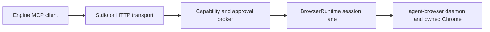
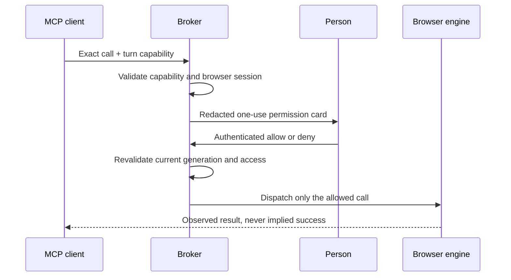
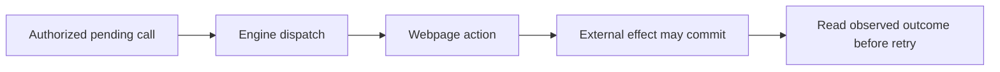
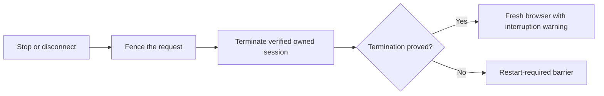

# 120 - Browser authorization and cancellation

Status: IMPLEMENTED and locally verified for the owned macOS browser; not cross-platform release-qualified or comparatively ranked.
Baseline: `3a7797656f`, branch `fix/dani-onboarding-updates-compact-sidebar`.

## Status ledger

- CONFIRMED_BY_SOURCE: agent-browser 0.37.0 is the default shipping engine; the native Chrome engine is opt-in. This change does not switch engines or introduce a dependency.
- CONFIRMED_BY_SOURCE: the browser-call broker now enforces one-use action approval at `/api/internal/browser/mcp`, reuses the existing card/event lifecycle, and cancels exact request generations. Chat Completions delegates only the harness-owned browser mount; the server gate remains authoritative for CLI engines.
- REAL_SERVING_PATH: seven disposable-home scenarios on agent-browser 0.37.0 passed, using the real browser with deterministic local model/CLI fixtures. They cover pre-approval denial, one-use submission, Full Access, two-browser isolation, one-card Chat Completions, URL-bearing reads, Stop after an RPC timeout, and native HTTP cancellation. Cancellation cases observe daemon/Chrome process identities exiting and usable fresh same-session work, not merely an absent POST.
- RED evidence: the new real-browser regression observed input requests before any approval on the baseline. A separate broker regression observed late success after cancellation before the post-execution cancellation check was added.
- VISUAL: the real BrowserPanel was exercised against a disposable failed-stop fixture in managed Chromium. Take control produced no normal action request, Restart remained reachable, explicit Restart succeeded, and subsequent navigation painted the fixture's field in a 1280-pixel browser frame. The recovery warning cleared. The temporary smoke scripts and fixtures were removed.
- RELEASE BLOCKERS: Windows hard-stop ownership proof and attached personal-Chrome page-effect cancellation are not equivalent to owned POSIX interruption. The Windows daemon identifies its session only through its environment (`third_party/browser/agent-browser-windows-stdio.patch`); the existing Windows process helper cannot prove that identity. Same-task comparative measurements are also still open. No claim that this engine beats alternatives follows from passing safety checks.

## Requirements

### R-BROWSER-001 - One enforced approval boundary

Before an agent-controlled browser action reaches the engine, the server must authorize that exact call. In Ask/Auto/Edits/Custom, potentially effectful calls require a one-use human approval. Full Access remains an explicit existing grant, not a second prompt. Known page observations need no write approval; arbitrary JavaScript, input, navigation, upload, dialog acceptance and unknown operations are never classified as observations. Browser tool search and native CLI approval settings cannot bypass the server gate.

### R-BROWSER-002 - Scoped and private approvals

An approval is bound to the requesting bot, thread, generation and browser session, and to the pending call in server memory. It is not a reusable client token or a blanket allowance for later clicks. Cards and decision events must not expose typed values, scripts, selectors, file paths, URL credentials or other user arguments; these display as `<REDACTED>`. Stop, expiry, stale generation, changed profile, human takeover and approval-service failure must fail closed before dispatch. The gate must use the existing approval-card/event lifecycle and authenticated answer routes.

### R-BROWSER-003 - Real cancellation of accepted work

Stop, turn-capability revocation and MCP request cancellation/disconnection must propagate to the active browser operation. For an app-owned agent-browser session, cancellation must fence queued/follow-up work synchronously and terminate the verified session's daemon and Chrome without waiting behind the accepted command. Do not report successful interruption until termination is proved. Failure to prove termination keeps a restart-required barrier. Late completion cannot restart or kill a replacement browser.

### R-BROWSER-004 - Honest outcomes and isolation

An effect already sent before cancellation cannot be undone. The interruption result must say that earlier work may have taken effect and must not replay it. A fixture action waiting before its POST must produce no POST after cancellation and the stop barrier. Other browser sessions, persistent sign-in files and the person's own Chrome process must be preserved. Attached personal Chrome is not owned by this server: do not kill it or claim the same process-level cancellation guarantee for it.

### R-BROWSER-005 - One shipping engine, evidence before comparison

Keep agent-browser and the existing browser tool surface. Stagehand/Pomerado remain unshipped experiments. Safety evidence uses a disposable fixture, real pinned browser and local target pages. A comparative claim requires the same tasks, model, permissions and recorded outcomes for every alternative; unavailable or incompatible engines are reported as such, not scored as successful.

## Design and ownership

- `server/index.ts` owns capability/generation revocation and browser route admission.
- A browser-call broker reuses `createChatToolApproval` and publishes the existing permission events. It owns pending browser approvals and request controllers, not a new scheduler or persistent grant store.
- `BrowserRuntime` owns the session execution lane, cancellation barrier and MCP client. The process-identity helpers own which daemon/Chrome tree can be terminated.
- The stdio proxy and Streamable HTTP adapter own only their connection/request lifetimes. Native HTTP cancellation must be scoped to the authenticated MCP session, never just a caller-supplied numeric ID.
- Chat Completions delegates approval only for a recognized harness-owned browser mount; a configured server named `browser` must retain its own gate. No raw-argument or preapproval assertion crosses this boundary.

### Responsibility graph

### Request sequence

### Effect path

### Cancellation and recovery

## Given/When/Then acceptance

| ID | Given | When | Then |
| --- | --- | --- | --- |
| AC-WRITE-001 | Ask-mode scripted CLI turn and a real local form | It requests fill/click/JavaScript submission | A permission card exists and no write reaches the target before allow; denial causes no write. |
| AC-WRITE-002 | A pending exact call | A different thread answers, the approval expires, the generation ends, the profile changes, or the service fails | No engine dispatch; a stale answer cannot allow a later call. |
| AC-WRITE-003 | Synthetic password, token, script and file-path canaries in arguments | A permission card/decision is published | User argument values are absent; `<REDACTED>` is present. |
| AC-WRITE-004 | Chat Completions with the actual built-in browser mount | It executes an effectful call | Exactly one server-owned card, not two; a custom server named browser still gets ordinary approval. |
| AC-WRITE-005 | An explicitly Full-Access conversation | It executes a permitted browser action | No duplicate permission card; live capability, access and cancellation checks remain enforced. |
| AC-CANCEL-001 | The owned browser is awaiting a delayed POST | Stop or MCP cancellation lands before the POST | The verified owned browser terminates; the target observes no POST after the delay, and the action is not replayed. |
| AC-CANCEL-002 | Queued, pre-aborted, launching or late-completing calls | Their request aborts | No new command slips through; failure to prove stop cannot unblock the session. |
| AC-CANCEL-003 | Two distinct active browser sessions | Only one call is cancelled | The second still answers and its page state remains intact. |
| AC-PRIVACY-001 | A browser request belonging to one capability/MCP session | A different capability/session reuses its request ID | Cancellation and answers cannot affect the first request. |
| AC-WRITE-006 | A native browser read includes a URL | The turn lacks Full Access | Navigation requires exact-call approval, and denial produces no target-side effect. |
| AC-CANCEL-004 | An accepted action outlives its RPC response/timeout | Its generation is revoked afterward | Stop still reaches the daemon; the delayed effect is not sent. |
| AC-CANCEL-005 | A signed HTTP scope expires while its request is active | A correctly scoped cancellation arrives | The old request is cancelled, but the expired scope cannot admit new work. |
| AC-ISOLATION-001 | A stale PID names a same-session daemon in another home/socket/namespace | Interruption inspects it | It is neither frozen nor killed; only a complete matching scope is eligible. |
| AC-ISOLATION-002 | Chrome outlives its daemon and its launcher rewrote HOME | Cancellation discovers the inherited ownership marker | Owned Chrome is stopped without deleting persistent sign-ins or claiming an ambiguous foreign process. |
| AC-RECOVERY-001 | A failed-stop barrier and closed old viewers | The person reopens the Browser panel | A recovery-only authenticated view exposes Restart while refusing ordinary input and performing no browser probe/launch. |
| AC-RECOVERY-002 | A retiring launcher or failed interruption proof | Idle cleanup or recovery attempts run | Inventory-only success cannot erase the barrier; old generations cannot recreate or stop a replacement session. |
| AC-RECOVERY-003 | Explicit recovery succeeds | Fresh connected page frames arrive | Normal navigation works and the restart-only warning clears without discarding external-effect warnings. |

## Verification and traceability

Use `docs/verification/README.md` and `launchVerificationServer`/`runControlOmb`, never the live app or real accounts. The previously observed unauthorized form submission and delayed post-cancel POST are the RED evidence; retain behavioral regressions for the corrected paths. Run the real server against pinned agent-browser and local synthetic pages, inspect target-side receipts, and remove temporary smoke scripts after proof. Focused browser/broker/transport tests, adjacent approval regressions, typecheck and lint must be recorded. New tests must assert effects, isolation, state transitions or security boundaries, not source wording or copied wiring. Update this ledger only with exercised evidence.

## Non-goals and limits

No engine rewrite, managed-runtime installation repair, background-job framework, new credentials, provider billing change, automatic retry, browser panel redesign, or release installation. The native opt-in Chrome engine is not promoted or independently release-qualified here. No cancellation scheme can retract a request already committed by a remote service. Page-provided content is untrusted and cannot authorize actions. This gate does not claim to sandbox every native shell tool or every autonomous script a remote webpage could run; unrelated capability/sandbox boundaries remain necessary.
