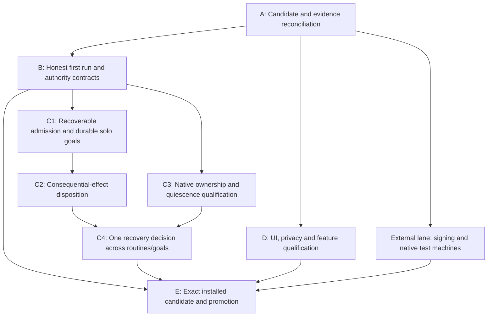

# Dani Desktop completion plan

Status: RESEARCH PROPOSAL, 2026-11-13. Implementation has not started under this packet. [Outcome/acceptance contract](spec.md) · [Executable work packages](tasks.md) · [Pending-work/evidence ledger](traceability.md).

## Start here

**First implementation tranche: reconcile the candidate and retained failures, fix supervised completion, restore provider fixture coverage without weakening its passing safety guards, then close the reproduced solo-goal identity gap.** Signing access and native-machine preparation start in parallel. Do not begin by restoring an old kernel, switching browser/agent frameworks or enabling new autonomy.

The end-to-end target is fresh install → honest readiness → original durable task → authorized effect → independently verified result → safe Stop/restart → installed upgrade. A text-only internal milestone is useful but does not close the broader voice/proactive/installed-product commitments.

### What this research changes

- The current code already has durable assignments, bounded continuation, Chief supervision/readmission, one-use browser approvals, uncertainty fences, accepted-send dedupe and native process helpers. Those are inputs to the plan, not missing features to rebuild.
- **Fresh fixture evidence:** explicit solo goal recorded a completed card while `runtime.db` had zero assignments and the pinned job view returned `idle`; ordinary chat in the same fixture created a completed root. Scope is `mode:"goal"`, not all direct work or routines.
- **Retained integrated evidence:** the 2026-11-13 08:23:44Z agent run records 677 passed, four failed, one pending: one behavioral Chief-verification failure and three default-fleet fixture assumptions. All seven substantive negatives from the earlier provider-boundary RED are individually passed in that integrated report. The separate native-provider suite records 101 passed in a narrower set. Overall integration is still red; neither the narrow pass nor the older RED changes that classification.
- The old master plan and tracker describe historical modules and payloads that are not today's serving owners. Specs120/130 retain older browser-version evidence. Status reconciliation is real pending work, not a reason to reconstruct absent modules.
- Existing release workflows and artifact validators are real. The pending work is candidate integration, trust/installation/upgrade qualification and public delivery; the helper-only latest-release observation is a shipping blocker, not proof no release system exists.

## ADR-160-01 — Keep current owners; reconcile execution contracts

Decision status: proposed implementation direction, consistent with the existing modular-monolith decision.

| Option | Consequence | Decision |
| --- | --- | --- |
| Extend the current runtime, tool gates and host factories | Retains existing isolation, event, migration and approval behavior; exposes specific identity/recovery gaps for bounded correction. | Recommended. |
| Recreate `DaniExecutionKernel` / another job or effect database owner | Creates competing authorities and requires re-proving every serving path; old checkmarks do not establish current integration. | Reject. |
| Adopt another agent/browser/framework or current Hermes gateway immediately | Changes session, permission, storage and cancellation contracts before the current failures are isolated. | Separate evidence-gated proposal only. |
| Rewrite renderer/backend or centralize all storage first | Broad regression surface without fixing a failing user path; file count or storage uniformity is not an acceptance outcome. | Reject. |

### Responsibility contract

| Concern | Owner after implementation | Contract |
| --- | --- | --- |
| Accepted request and execution/recovery decisions | Existing assignment runtime/coordinator | Stable original-message/assignment identity; transitions, waits, continuation and recovery agree across entrypoints. |
| Agent reasoning, model exchange and native session | Version-qualified Hermes ACP adapter | Exact provider/model/protocol/profile binding, no silent substitution; native capabilities explicitly qualified. |
| Consequential effect admission and result reconciliation | Existing typed tool/service gates, correlated to the runtime | Persist admitted attempt before dispatch, recheck authority, retain receipt/non-application/unknown; native trusted modes are separately identified. |
| Schedule timing and definitions | Existing `RoutineManager` | Trigger execution using runtime identity; consume the shared effect/recovery disposition instead of independently replaying work. |
| Goal cards, transcript and UI | Existing projection/storage owners | Project authoritative execution state; preserve presentation and history, not an additional goal scheduler. |
| OS grants, embedded-server/native-helper lifecycle and packaged updates | Electron main and current supervised helpers | Exact-child identity, capability delivery, retirement/readmission contract and native trust chain. |

This is one execution authority, not a requirement that every domain object move into one database. Logging every read is not an effect-safety requirement.

### Proposed interface invariants

Use current assignment/request/generation identifiers rather than inventing parallel identifiers. The implementation slice must define these contracts before exporting new symbols:

- **Admission receipt:** original request/send identity, workspace/thread/owner, durable assignment reference and accepted-versus-not-admitted outcome. Repeated admission returns the same receipt or a conflict, including after a partial cross-store commit.
- **Effect attempt:** admitted operation identity, private canonical argument/precondition digest, exact resource and approval scope, owner/generation, dispatch disposition and minimal target reference/evidence. Attempts are immutable history; credentials/raw secrets are not ledger payloads.
- **Unknown disposition:** distinguish not-dispatched, target-confirmed, proven non-applied and submitted-but-unresolved. Existing job/card vocabularies must expose this consistently without treating a blocked reason as successful completion. Choose the smallest compatible wire/storage change; the legacy canonical-UNKNOWN requirement remains open until that mapping is explicit and proven.
- **Retirement:** capability revoked, cancellation requested, protocol settled and native work quiescent are different facts. A late callback cannot revive a cancelled generation or retire its replacement. If the necessary stop/identity proof is unavailable, keep readmission blocked and report why.
- **Readiness receipt:** app artifact, agent/interpreter/source/profile identity, ACP capabilities, selected provider/model/protocol and the freshness/scope of verification. Discovery metadata, native tool qualification and actual task qualification are separate levels.

## Phase dependencies

Independent narrow repairs can proceed after A; the graph gates enabling/promotion, not every source edit. Adding safe effect records can proceed before native qualification, but automatic readmission cannot claim safety until its native/effect gates both pass. Schedule definitions, memory formats and unrelated UI remain stable during execution changes.

## A — Reconcile the candidate and real backlog

Owner: integration maintainer. Tasks: C-00 and the evidence portion of C-01/C-02 in [tasks.md](tasks.md).

1. Preserve all existing user changes; identify the intended integrated candidate and actual serving files without reset, blanket staging or pulling over the working tree.
2. Reconcile tracker#21, historical specs/traceability and specs120/130/140 against current source. Preserve dated historical achievements, but attach current evidence and exact scope to every completion claim.
3. Triage retained failing acceptance records without rerunning merely to confirm them. Behavioral authority/credential/continuity failures need fixes; wording/copy/cardinality assertions that are not consumer contracts should be removed rather than re-pinned.
4. Establish exact baseline CI/build/package outcomes for the chosen candidate during implementation. The remote main CI failure is not a test result for this dirty working tree; a small local pass is not integrated CI.

**Exit gate:** every entry in [traceability.md](traceability.md) has a state, owner role, implementation/evidence link, closure gate and dependency. No candidate is called green without current complete required checks.

## B — Make installation and readiness truthful

Owner: provider/onboarding maintainer, with desktop/security maintainer. Tasks: C-02–C-05, C-11 and the conditional free-route canary C-25.

1. Restore fixture isolation around configured-provider discovery while preserving the now-passing credential/refusal guards. Then implement verified health/freshness, correct saved-key Connected labels and enforce explicit first-metered-use acknowledgement at every billable ingress, including ordinary dispatch and Live session creation bound to its actual voice provider/model. A catalog row, saved key, spend cap or probe consent is not equivalent to those requirements.
2. Finish the fresh primary onboarding screen's Hermes cutover, not only the secondary connection card. Repair the synthetic Hermes fixture to satisfy current qualification, separate process availability from model/task readiness, and make modality labels reflect actual model-plus-transport support. Preserve fail-closed model gates.
3. Prove the managed Hermes/interpreter/dependency payload and licensing path per advertised target. The developer's existing virtualenv and source launcher do not satisfy clean-machine bootstrap. Keep task-ready blocked if no legal compatible free/local route or explicit selected credential is available; retain the zero-step requirement as pending rather than silently changing its meaning.
4. Qualify repair/reload/update during an active turn using the existing provider lifecycle: no orphaned busy state, lost reply, overlapping profile owner or repeated consequential operation.
5. State packaged/dev/headless/service/remote authority separately and close the sessionless shared-worker overlap. The external worker caller must migrate with the server contract; no compatibility bypass. Restrict executable probes to discovered adapters or canonical custom paths explicitly selected by the owner, with fixed no-shell arguments.

**Exit gate:** clean-machine app/runtime/provider readiness is accurate, the exact selected native route consumes a real unpredictable tool result under authorized probe budget, and all enabled entrypoints obey their documented authority. This does not yet prove autonomous task success.

## C — Close durable execution and recovery gaps

Owner: runtime maintainer; desktop/native maintainer owns OS-specific proof. Tasks: C-01, C-06–C-10 and C-12.

1. Add the unreadable-registry write barrier and recoverable immediate admission before broadening job recovery. Missing-new-install and unreadable-existing data must not be conflated.
2. Give explicit solo goals a durable existing-runtime root/run relationship. Preserve existing ordinary roots, room step roots, goal-loop budgets, card display and scoped Stop semantics.
3. Implement one mediated consequential operation end to end with durable attempt/receipt/unknown handling. Prove target-side effect count at crash/acknowledgement boundaries; preserve specialized existing journals.
4. Make runtime/routine/goal retry policy consume that disposition. Unreadable evidence is not an empty safe-to-retry result. Read-only recovery is distinct from denial or unknown writes.
5. Qualify native process/profile ownership and post-crash retirement before enabling replacement/readmission. Then close the existing Chief/worker continuation and late-Chief acceptance using the original goal, same owned root, permission ceilings and target evidence.

**Exit gate:** original request, card, job view, effects and target receipts agree across Stop, denial, response loss and restart. A target without reliable reconciliation remains visibly unknown. No artificial guarantee of exactly-once effects is made for unmediated native execution.

## D — Finish product resilience and declared capabilities

Owner: renderer/desktop maintainer; memory/proactivity and voice owners qualify their branches. Tasks: C-13–C-19.

1. Bound hydration requests/buffers, isolate hung peripheral loads, reconcile room-send response loss and fence stale workspace operations. Preserve the existing single SSE projection and message dedupe.
2. Classify secret storage and workspace scope. Qualify the shipped Linux async vault backend under working/missing/locked services; availability or a legacy backend label alone is not an OS-backed protection guarantee. Preserve recoverable ciphertext and existing transactional writes.
3. Verify memory correction/forgetting/retention/audience behavior on the current Markdown/journal path; do not add the deferred SQLite sidecar just because an old spec names it. Verify proactivity trigger → deduped proposal → approved execution → evidence through the shared lifecycle, including quiet hours/DST/snooze/Stop and flag-off behavior where committed.
4. Qualify the actual voice mode and computer backend per claimed OS/device. Distinguish dictation, speech playback, Realtime conversation and local duplex. Accepted physical voice/offline commitments stay open until met; platform gates are not bypassed to make a demo work.
5. Extract only ownership-focused host/route/store modules during related work and measure existing startup/idle/stream/cancellation benchmarks. Preserve behavior; define measured budgets before optimizing process count or database synchronization.

**Exit gate:** renderer/privacy/native capability promises match observed behavior. Unsupported modes are visibly unavailable; that is a truthful intermediate release, not completion of an accepted full-feature criterion.

## E — Qualify and deliver the exact installed product

Owner: release maintainer, with authorized signing/repository owners and native verifiers. Tasks: C-20–C-24.

Start signing identity, repository-permission and machine preparation during A. Do not wait until the last implementation slice to discover these prerequisites.

1. Build the pinned integrated candidate with current required CI completed, full combined asset/feed validation and provenance. Distinguish reproducible payload from attested signed/stapled release bytes; any change to the old exact-hash criterion needs approval.
2. Exercise clean install, setup, real selected-provider turn, approval, task evidence, Stop/restart, workspace retention and upgrade on macOS arm64/x64, Windows x64 and Ubuntu's claimed formats/backends. Existing Linux packaging or Windows NSIS fixture evidence narrows work; it does not certify every target.
3. Prove signed/trusted N→N+1 update and supported failure recovery using exact downloaded bytes. Preserve vault identity and data; never use an unsafe downgrade or silent older-database restore to erase newer effect receipts.
4. Retain spec090/spec100's 20 consecutive installed clean-profile demo runs and two rehearsals where required; supplement them with boundary/forbidden-outcome checks rather than presenting repetition alone as a safety proof.
5. An authorized maintainer publishes a complete desktop release and checks public feeds/assets back. Auxiliary browser releases are non-latest; missing feeds remain errors. Operational scope, staged rollout/kill-switch policy and privacy disclosures must be explicitly reconciled with the local-first product, not silently implemented as remote telemetry.

**Exit gate:** every claimed platform/feature has exact-artifact acceptance; remaining approved requirements and unapproved/parked proposals are visibly separate. Uploading a draft, a source push or a successful package build is not shipping.

## Rollout and rollback

- Use one bounded vertical slice per change. Data migrations first define version/reader compatibility, backups and reconciliation; live work is not an experiment target.
- For new effect/recovery behavior, keep uncertain automatic execution unavailable until intent, authority, target observation and retirement gates pass. Switching off the new path must not reactivate an older retry path that ignores its receipts.
- Rollback code only with a compatible state reader or an explicit safe recovery mode. Preserve accepted requests, grants, newer attempt receipts and unknown dispositions. Restoring a local DB cannot undo an email, payment or committed browser action.
- Runtime activation changes only after the pinned probe succeeds, retains a verified previous payload and owns the native profile being updated. It does not mutate the user's global native installation.
- Public release rollback follows updater version/signature policy. Existing downgrade refusal remains intact; use a newer recovery release when necessary. Version/data surgery is not an acceptable ordinary recovery mechanism.

## What to stop, change and preserve

| Direction | Decision |
| --- | --- |
| Rebuild a named historical kernel, add another retry scheduler or generic completion judge | Stop. Extend the current owner and close a reproduced/fault-bounded seam. |
| Swap browser engines to cure the agent's stopping behavior | Stop. Existing engine safety and agent continuation are different contracts; any comparison remains evidence-gated. |
| Claim ready/connected from CLI presence, saved key, `/models`, HTTP200 or final text | Change to capability-, entitlement-, protocol- and tool-result-qualified state. |
| Treat every error as retryable, or every failed observation as permanent denial | Change to typed read recovery, refusal, resource wait and unknown-effect dispositions. |
| Declare current acceptance from old commits, filenames containing `green`, narrow passes or mock completion | Change to exact candidate/evidence scope and retained failed/unrun gates. |
| Require a 300-line root or ban words in bundles as the main correctness proof | Recommend replacing with ownership/reachability and behavioral product gates. Those old criteria remain open until an explicit amendment; this packet does not waive them. |
| Force global storage/pool/profile consolidation before useful repairs | Stop. Preserve distinct domain state; fix actual authority, partial-commit and native ownership contracts. |
| Add Laya, hosted autonomy, WhatsApp/mobile/domain expansion to the base critical path | Keep explicit proposal/parked decisions. Preserve existing remote clients and security; do not remove them or claim future work delivered. |
| Current Electron/React/Node/Hermes stack, browser broker, runtime tree, single-writer leases, bounded continuation and deterministic fast paths | Preserve. These are substantial existing mechanisms and test surfaces. |

## Review and evidence gate

Each implementation slice supplies: requirement/task IDs, exact file/interface map, baseline and changed candidate, regression/fault scenario, serving-path smoke, native/real evidence where required, privacy/performance check and safe rollback. Review spec compliance, security, performance and locality separately. Resolve source-proven findings before promotion; record unexercised external/native prerequisites rather than producing a fake green result.

This packet itself is documentation/research, not a current full-suite, provider, hardware or installed-release pass. See [traceability.md](traceability.md) for evidence and [tasks.md](tasks.md) for the first concrete work packages.

## Research packet verification

- Five documentation files were checked: the four-file packet and its `specs/README.md` entry point. All 75 local references resolved with valid source-line ranges; all 12 requirements have task coverage, all 12 acceptance gates and 26 work-package IDs are unique/defined, and implementation boxes remain unchecked.
- The dependency diagram passed Mermaid syntax parsing with the installed parser in a fresh Node/DOM environment. This is not visual or application verification.
- Independent spec/dependency and security/performance/maintainability reviews found five planning omissions. The revision restored the CI/installed free-route canary, per-turn server-log timings and per-supported-provider live matrix, and explicitly included paid Live ingress and custom-executable selection. Both read-only rereviews reported no remaining material findings in their assigned scopes.
- The fresh runtime observation is the isolated goal-versus-chat comparison recorded in `traceability.md`; its owned launcher exited0. No build/test/typecheck, real-provider/native-device qualification or installed-release promotion was performed during this planning task. Retained failing records were inspected rather than rerun for confirmation.

The research deliverable is complete; the application work remains pending until its implementation and acceptance gates are actually satisfied.
