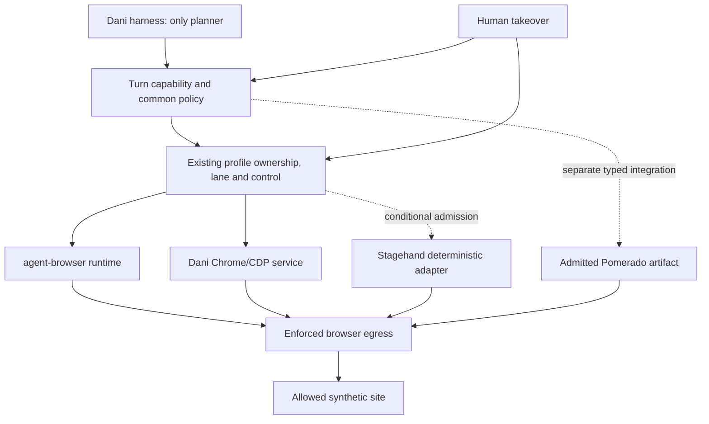

# Browser use: plan

Status: **approval packet; no implementation authorized**. Decision: adopt neither now. The proposed next approval is an evidence phase, not a product integration or enablement. See [spec](spec.md), [constitution](constitution.md), [baseline](baseline.md), [clarifications](clarify.md), and [ordered tasks](tasks.md).

## 1. Scope and decision gates

**This branch:** only six Markdown artifacts under `specs/browser-use/`. No flag, dependency, runtime route, model provider, installer, onboarding, physical-use or harness-experiment change. Candidate flags added: **none**. Effective candidate state: **absent/not enabled**, not an implemented default-off feature.

**Gate G0 — now:** submit this packet and docs-only PR. Stop before candidate code, SDK installation, minting or model comparison. Latest owner permission permits a PR, not implementation.

**Gate G1 — only after go:** perform T02–T07 in an isolated experiment directory/worktree: freeze evidence inputs, compare both existing engines, define a common contract and inspect candidate compatibility/admission. A new comparison runner or attachment spike is build work and has not been created in this phase. Default paid spend is $0; no cloud, real accounts or optional minting.

**Gate G2 — separate adoption decision:** only a candidate with demonstrated benefit and no unresolved C1–C9 blocker can have product implementation and acceptance tasks T08–T24 approved. Changes to existing write policy need explicit approval because C3/A4 is stronger than current behavior. No implicit authorization from a successful compatibility probe.

**Gate G3 — separate enablement decision:** all A1–A12 evidence, no new regression, native platform proof, packaging/trust checks and owner approval precede enabling a candidate. Otherwise remove the experiment or keep it outside the product; do not ship inactive residue just to show progress.

## 2. Why now and alternatives

The complete September decision was read. Its explicit rejection was a second model loop, not a measured universal performance result. Stagehand v4's removed `agent()` changes that particular premise; model-driven multi-action/recovery paths and browser-wide ownership remain concerns. Pomerado separates mint from execution locally, but authoring is itself model-driven and cloud repair can replace/re-execute code. The single-planner requirement is not waived.

The historical error-flood stall is a specific investigation seed, with source/fixture links in baseline. No matched task result shows either candidate fixes it. The current proxy/eval failures are baseline hygiene issues, not a browser replacement justification. No private traces are needed to make the present no-adoption decision.

| Option | Current evidence | Decision now |
|---|---|---|
| Keep default agent-browser | Real pinned-runtime Intel Mac smoke; established host/capability/egress path; historical observation limitations | Keep unchanged. |
| Keep optional Dani Chrome/CDP | Existing native Intel Mac checklist; common profile/control service; not full default-engine evidence parity | Keep unchanged and include as an equal comparison arm. |
| Stagehand4.4.0 backend | v4 has no top-level agent loop, but extension attach/ownership, hidden inference paths and domain-policy gaps remain; native Dani integration not run | Do not adopt; consider only isolated deterministic compatibility proof after G1. |
| Pomerado typed integration | Local deterministic execution is distinct from mint; native Windows prohibited; generated code unsandboxed; stock MCP hints insufficient | Do not adopt; optional immutable/BYOK authoring and containment proof must precede any runtime admission. |

All source versions, public citations and corrected facts are centralized in [clarify.md](clarify.md). Matched comparison count is zero for every option; no speed/cost winner is asserted.

## 3. Ownership and enforcement design, if later approved

### Responsibility

Dashed paths are proposed, not existing code. In particular, no current gate is claimed to confine arbitrary Pomerado subprocess networking.

- Harness owns planning, model selection and turn lifecycle. Existing server owns capability, effect authorization, profile/audience identity, serialization, secret release/redaction and result delivery.
- Reuse `server/host/browser.ts`, `server/browser/engines.ts`, `service.ts`, `dispatch.ts`, `backends.ts`, `control.ts`, `session-control.ts`, `audience.ts` and `egress/`; do not fork a second service/profile/approval owner.
- `backends.ts` currently returns Dani's `CdpBrowser`, not a generic SDK handle. Stagehand is **not** a drop-in implementation. A future adapter must sit behind the existing dispatch/connection boundary while preserving its owner; inability to do so disqualifies it rather than justifying a new top-level agent.
- Pomerado remains separately typed MCP, never an engine selected to bypass browser gates. Generic custom-MCP configuration does not count as admission.

### Request and effect path

1. Authenticate the current turn and resolve server-owned profile/audience.
2. Validate operation/schema, artifact revision, exact destination and allowed data categories. Treat page content, tool descriptions and MCP effect hints as untrusted.
3. Apply common permission/egress policy. Resolve ambiguous effects as write/unknown, never read.
4. Require a matching one-use write approval or exact recorded owner grant before a write. Bind it to generation, profile/audience, tool/artifact digest, normalized arguments, destinations, expiry and approved effect. Recheck after asynchronous waits and before dispatch.
5. Acquire the existing profile lane/control reservation. Check cancellation/takeover again; execute one admitted primitive or bounded immutable integration operation.
6. Enforce actual network/process/file effects, not merely the outer MCP request. Direct sockets, subprocess HTTP, redirects, uploads, auth redirects and model/cache/telemetry endpoints must not escape the same policy. If no enforced boundary exists on a platform, the candidate is unavailable there.
7. Verify actual resulting state independently; scrub before model context, UI, logs, traces or files. Recheck generation/audience before returning.

### Crash, cancellation and recovery

Revoke new dispatch immediately on cancellation/takeover. Reject queued/late work and stale refs. Track an accepted effect as uncertain until reconciled; a timeout is not rollback. Never replay a possibly committed submit or auto-remint it. Close only owned resources, never the person's attached Chrome. A failed stop/detach keeps the candidate unavailable and reports uncertainty; a later read-only reconciliation needs its own valid capability. Existing job/turn ownership remains authoritative; upstream job IDs are evidence, not a second scheduler.

Proposed **experiment thresholds**, not measured product SLOs: no new dispatch after the cancellation/takeover event; refusal of new calls within1s; stop owned in-flight candidate process/connection within10s and verify no owned orphan at that bound; offline new-call failure within15s. Run each cancellation/offline/takeover case10 times and report every sample/max. If a backend cannot meet the bound safely, fail admission rather than extending it after seeing results. Do not kill a shared/user-owned browser to manufacture success.

## 4. One browser contract, no prompt fork

Use `server/browser/tools.ts` as the canonical typed vocabulary. The logical categories below are **not new public tool names**. Preserve the existing tool names/semantics and inventory; backend adapters translate privately. Baseline prompts currently differ between engines, so prompt equivalence is a future comparison/contract requirement, not a claimed current property.

| Logical category | Existing surface to preserve | Required semantics |
|---|---|---|
| Navigate | `agent_browser_open`, `agent_browser_navigate`, tab navigation | Explicit authorized target; allowed schemes; readiness/deadline; new generation invalidates old refs. |
| Observe | `agent_browser_status`, `agent_browser_snapshot`, `agent_browser_screenshot` | Bounded text/image, provenance, sensitive-capture policy; no implicit model call; observe cannot read through human hold. |
| Act | click/fill/type/press/select/check/hover/drag/scroll/upload/dialog | One explicit operation under ownership and effect policy. Fill-submit, Enter, click and dialog acceptance are potential writes, not harmless UI events. |
| Extract | `agent_browser_read` plus approved structured read projection | Deterministic bounded extraction from the authorized page; opening a URL is navigation with egress checks. Default engine's separate HTTP read bypass remains refused. |
| Lifecycle | tabs/wait/close/`restart_browser` | Profile-local scope; no close-all; bounded waits; close/detach respects owner. |
| Exceptional eval | Existing `agent_browser_eval` | Preserve existing restrictions in regressions; exclude arbitrary eval from new candidate admission unless its effects can be authorized/enforced. |

Private execution context must carry turn/profile/audience identity, deadline/cancellation, effect/approval reference, egress decision, and output/redaction budget. These are server-owned, never free-form model authority. Results distinguish verified completion, refusal, not configured/unsupported, cancelled, failed and uncertain effect. Stable labels do not hide backend errors. Unknown output usage/cost stays unknown.

## 5. Candidate-specific admission

### Stagehand

Pin **4.4.0** and the SDK/extension source identity from clarify; no caret/latest resolution in a candidate lockfile. First probe uses a new synthetic owned browser/profile, no personal My Chrome, no cloud/cache/telemetry/provider key. Test attachment through a deliberately reviewed connection endpoint; Dani's existing pipe is not assumed compatible with a new WebSocket client. No unsafe browser flag is silently added to production.

Allow only explicit-target deterministic snapshot/locator primitives initially. Exclude string `act`, model-backed observe/extract, self-heal, cache fallback, automatic gateway selection and page-provided tools. `selfHeal:false` alone does not block cache replay's inference fallback. Prove zero SDK model requests; any future perception callback through the existing model boundary needs a new bounded-call approval.

`browser.disconnect()` must preserve the owner browser and remove candidate authority on normal/failed/late init. Never use attached `browser.close()` as detach. Test sibling targets, extension-wide policy, profile locks, takeover and teardown races. If the extension cannot be contained without a new owner/stack, stop with no adoption.

Derive any `setDomainPolicy` restriction from Dani's authoritative egress decision; do not keep a second user allowlist. Empty allowedDomains is not deny-all. Continue to enforce IP classes, ports, redirect/subresource and backend traffic outside that helper. An extension exception cannot exempt model or telemetry traffic from Dani policy.

### Pomerado

Pin the release plus source/import closure of each generated artifact; distinguish release from inspected HEAD. A typed admission record binds package/runtime version, code/manifest/schema digests, declared and reviewed effects, auth origins, allowed destinations, audience, input/output schema, commit semantics and cancellation/retry behavior. Any source/schema/destination/revision change invalidates grants and admission.

Authoring is separate, owner-authorized BYOK with a monetary cap, synthetic website scope and quarantined output. It may perform example writes; treat mint itself as consequential. Runtime cannot access mint/review/remint/repair tools or model credentials. Stock local write hints, optional idempotency keys and confirmation templates are not Dani approval. An uncertain write is reconciled, not blindly rerun.

Do not admit the stock unsandboxed executor as safe by wrapping only `tools/call`. Reuse common enforced process/network/file boundaries if they actually constrain its full execution; otherwise remain unavailable. No WSL, new runtime stack or hosted fallback is introduced to paper over Windows rejection or Node<25 constraints. Cloud auto-repair is excluded because immutable revision/repair-disable/approval contracts are unverified.

## 6. Provider, keys, privacy and onboarding

- Existing harness/model layer stays unchanged. No harness chooser, curl instruction, onboarding key prompt or implicit paid fallback.
- Optional mint key, if later approved, uses the existing `electron/main.mjs` / `secure-credentials.mjs` / `workspace-credentials.mjs` boundary. Store a separate purpose-scoped credential, not a plaintext MCP config or `.env`; release only to the authorized authoring operation. Do not inherit a broad ambient environment or repurpose another provider's key.
- Missing key/platform/store yields a clear not-configured/unsupported/unavailable state. Unavailable storage is not empty storage and cannot justify overwriting saved values.
- Browser pages and generated tool outputs are untrusted. Never upload user traces/cookies to a candidate/editor/vendor in this phase. Synthetic fixtures carry planted fake secrets; check every sink including screenshots/headers/error paths. Cloud data transfers/retention are a separate future approval.

## 7. Pre-registered comparison design

**Not run.** G1 must freeze the experiment manifest before any scored task or candidate result. No benchmark code or mock result is part of this PR.

### Conditions and arms

- Arms: default agent-browser; Dani Chrome/CDP; conditionally admitted deterministic Stagehand; conditionally admitted Pomerado integration **on the unchanged incumbent browser for tasks outside the integration's declared scope**. That fallback scope is frozen, explicit and included in cost/step totals, not chosen after failures.
- One identical harness/planner prompt and canonical tool contract; same approved free model/provider route, exact model identity/version where available, temperature/seed/settings/context budget, tool permissions, account fixture and human-action schedule. No stronger hidden candidate model.
- Before running, resolve one approved free text/tool-capable model through the existing model layer, freeze the manifest and availability evidence; if unavailable or changing, stop the batch. No valid identity means **not run**, not a substituted model or simulated win. No personal credential search to find one.
- Prefer the same exact full-Chrome binary/hash for all admitted arms; record executable, flags, extension/runtime revisions, OS/CPU and cold/warm state. If an arm requires an incompatible browser, report it as a separate non-equivalent experiment and do not use it for the primary adoption rule.
- Synthetic isolated sites only. No external account login, purchase, post or personal trace. Any later live-site study requires owner-authorized disposable accounts/data.

### Frozen task set

| Case | Task and independent success check |
|---|---|
| K1 | Open-ended research across a synthetic multi-page site; answer facts and cite correct source URLs, checked against fixture facts. |
| K2 | Known-site filter/search and structured extraction; exact expected rows, including duplicate labels and a stale ref. |
| K3 | Repeat a known-site document download; verify bytes/hash and correct account-local data, not click success. |
| K4 | Submit a purchase-like synthetic form: deny first, then approve an exact payload; server-side effect ledger shows0 denied and1 approved commit. |
| K5 | Recover observation after DOM replacement/iframe change; correct target acted on, wrong/sibling target unchanged. |
| K6 | Error-flood workload derived from the committed historical fixture; report page outcome and missing telemetry honestly, measure latency/loss without treating silence as no error. |

Ten independent repetitions per case/arm, with reset fixture/profile and balanced seeded interleaving. T04 performs at most12 deterministic no-model runner-control checks, reported separately and never used as scored performance data. Once T05/T06 determine candidate eligibility, T07 runs the complete interleaved initial phase, including both current engines:60 scored runs/arm,120 with incumbents alone or at most240 with all4 arms. T22 repeats the complete final phase, so the maximum is480 scored runs across2 phases, plus the12 explicitly unscored controls. Non-admitted arms are **not run**, not zero failures. Preserve all unsuccessful attempts; no best-run selection. Case deadline180s, maximum24 planner tool steps and50,000 reported total tokens/run. Exceeding a cap is a failed/capped run, not a longer hidden retry.

Pomerado minting is not a scored free runtime run: record build/review/model cost, examples, failures and repair attempts separately and amortize over1,10,100 repeated uses. Default authoring allowance is0 operations/$0; a later owner grant must set an explicit cap before any mint. No cloud repair arm.

### Metrics and raw record

For every run persist: source/manifest/corpus digests, arm/case/replicate/order, model/settings, platform/browser/SDK/artifact identity, start/end monotonic times, terminal state and independent success reason, planner/tool/native-step counts, retry/repair/human counts, input/output/cache/reasoning tokens, actual monetary charges and their source, cold/warm setup, and failure category. Keep raw event receipts redacted. If token/cost telemetry is incomplete, mark unknown and disqualify a cost-saving claim; do not use the skill-bench chars/4 estimate as real billed usage.

Publish per-case denominators, success counts, all failures, median/IQR and p90 wall time/steps/tokens; paired deltas and a task-stratified bootstrap95% interval for wall-time improvement. Exact sample sizes and raw values accompany summaries. No extrapolation from B2/B3 or one vendor demo.

### Adoption rule fixed before results

Safety cases are hard gates. For task performance, a candidate must complete at least57/60 cases and have no fewer successes in any task than **either** current engine. **Wall time is the fixed primary metric** for this free-model experiment: at least20% lower paired median wall time versus both baselines, with the95% interval excluding no improvement. Neither p90 wall time nor total token consumption may regress more than10%. Token consumption is provider-reported input plus output; input already includes cache reads/writes and output includes reasoning, so those subfields are not added again. Monetary charges are a separate USD metric, not synonymous with tokens; zero-charge baselines have no percentage-saving calculation. Under the $0 cap, any positive charge fails, zero against zero is equal cost, and unknown charges or incomplete token telemetry prevent adoption. For any zero token denominator, non-regression requires the candidate also report zero; otherwise it fails rather than dividing by zero. These are proposed decision margins, not measured product SLOs. Insufficient samples, an unresolved interval or unavailable telemetry yields **no adoption** with uncertainty stated. Platform/ownership failure also means no adoption regardless of speed.

## 8. Packaging, platforms and rollback

Actual platform matrix is in baseline; only existing-engine Intel Mac functional checks were executed. Candidate native rows remain not tested. Native source support is not execution proof; Pomerado Windows is explicitly unsupported in the inspected local source.

This docs proposal has no installer delta. Registry package-only sizes in clarify exclude transitive packages, Chromium, extensions and runtimes. Before any product candidate: lock exact versions/transitives, verify archive integrity/source provenance, retain both MIT notices and dependency notices, measure compressed download/install/artifact bytes, startup/RSS and cold/warm work on each native platform. Stagehand's extra Zod copy is not a reason to downgrade Dani. Pomerado's Node range/Playwright dependency is not a reason to swap the desktop runtime.

Offline Linux packaging is already broken before browser integration; preserve that failure and require separately proved baseline repair, then exercise the existing offline package path with network blocked and staged dependencies. No runtime downloads or cloud fallback may make an offline test appear successful. Windows/Mac Intel/Mac Apple Silicon/Linux x64 packaging and owned-process shutdown must each be run natively before those support claims.

Rollback now is a documentation revert. Later experiment rollback removes only its owned temp profiles/artifacts/processes and restores the unchanged baseline; no user data deletion. An adopted candidate would disable its flag, revoke grants, detach/stop only its owned resources, remove its route, and preserve existing engine selection. Generated-source revision and profile format never silently migrate user data. Ambiguous writes remain evidence to reconcile, not replay during rollback.

## 9. File scope and test plan

Current files: `baseline.md`, `constitution.md`, `spec.md`, `clarify.md`, `plan.md`, `tasks.md` under this directory.

Potential G1 files live **outside the repo**: frozen manifest/corpus, comparison runner/adapters, isolated attachment/containment probes and redacted JSONL receipts. They may import inspected baseline modules; they may not patch production to pass.

Potential G2 product scope, **not approved or created**:

| Concern | Existing files to reuse / bounded additions if justified |
|---|---|
| Shared tool/policy/lifetime contract | `server/browser/tools.ts`, `dispatch.ts`, `service.ts`, `engines.ts`, `backends.ts`, `server/host/browser.ts`, browser route in `server/index.ts`, `server/harness-mcp-proxy.ts`; their existing behavior tests |
| Takeover/audience/egress | Existing `control.ts`, `session-control.ts`, `audience.ts`, `egress/` tests; no second policy list/lease |
| Stagehand adapter | A new private adapter under `server/browser/` only if G1 proves fit; existing default-off config schema in `server/browser/config.ts` would be extended, not routed by default |
| Typed Pomerado | Private admitted-integration adapter; `server/host/mcp-servers-host.ts`, `server/mcp-gate.ts` and browser host policy; no generic trust of annotations |
| Purpose-scoped encrypted BYOK | Existing Electron credential boundary and its contract tests; no onboarding/model provider changes |
| Packaging/licenses | `package.json`, `pnpm-lock.yaml`, existing browser preparation/smoke paths and `third_party/` notices only after measured need; no CI failure suppression |

T08–T24 and A1–A12 specify the tests. Any larger change, new stack/runtime, permission redesign or platform workaround returns to G2 rather than expanding silently. Decisions Q01–Q27 remain authoritative in clarify; unresolved ones block the affected stage. **Stop here for approval.**
